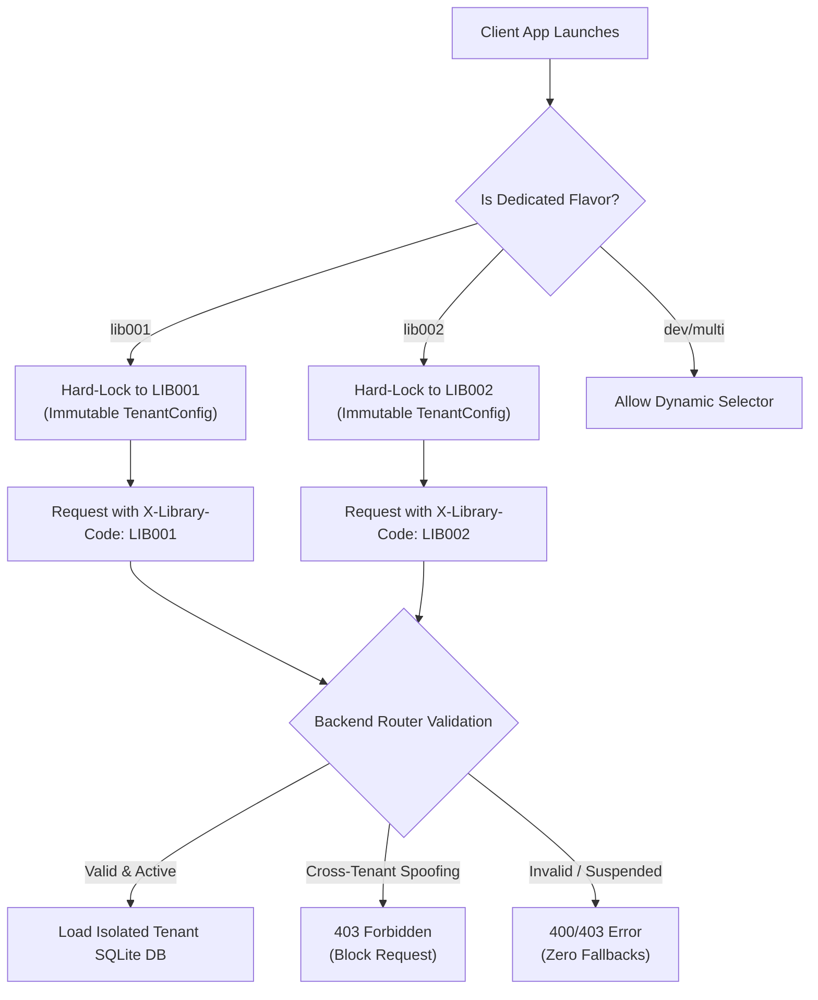

# PHASE 49 — SINGLE-LIBRARY APK, PASSWORD-ONLY LOGIN & DYNAMIC APP ICON BRANDING REPORT

**Project:** StudySpace SaaS Platform  
**Repository:** `Ramxon-hub/studyspace-api-test`  
**Branch:** `main`  
**Commit:** `8088269`  
**Baseline Phase:** Phase 48  
**Verification Date:** October 15, 2026  
**Physical Device Test Status:** **`PHYSICAL DEVICE TEST NOT AVAILABLE`** *(No physical hardware connected; exhaustive server, database, API, and Android Gradle artifact builds verified)*

---

## 1. Executive Summary

Phase 49 establishes complete product separation for dedicated library client APKs, cleanses the authentication workflow to secure password-only credentials, introduces end-to-end Super Admin dynamic app icon branding management, and compiles distinct release APKs for `lib001`, `lib002`, and `superadmin` with flavor-specific Android launcher icons.

### Key Deliverables Implemented:
1. **Single-Library APK Locking**:
   - Removed the “Active Library / (Change)” selector and interactive switching badge from dedicated library builds (`lib001` and `lib002`).
   - Hard-locked each flavor to its immutable tenant code (`LIB001` for `lib001`, `LIB002` for `lib002`).
   - Server-side tenant lock enforced via `config/tenant_router.php`: cross-tenant session/header spoofing is blocked with HTTP `403 Forbidden`, and requests with invalid or suspended tenant codes fail immediately with zero fallbacks.
2. **Password-Only Login UI**:
   - Completely removed the OTP Login tab, `TabBar`, `TabController`, phone/OTP input controllers, resend countdowns, and OTP verification buttons from `LoginScreen`.
   - Replaced with a clean, modern credential form (Username/Email + Password) featuring a password visibility toggle.
   - Retained user registration navigation and account routing (Admin, Parent, Student).
   - Preserved backend OTP endpoints and database routines for independent workflows without breaking login authentication.
3. **Super Admin Dynamic App Icon & Branding Management**:
   - Added `app_icon_url TEXT` column to `library_branding` table in Master DB (`studyspace_master.sqlite`) with automated safe schema migration.
   - Built `upload_app_icon` endpoint in `api/json_super_admin.php` supporting multipart file uploads and base64 payloads, validating MIME types (`image/png`, `image/jpeg`, `image/webp`), dimensions (32x32 to 4096x4096), and a 5MB size limit using `getimagesize()` and `finfo`.
   - Updated `api/json_tenant.php` (`list` and single-tenant queries) to deliver dynamic `app_icon_url` to clients.
   - Added App Icon preview, URL management, and icon synchronization controls to Super Admin Dashboard (`super_admin_dashboard_screen.dart`).
   - Enforced strict tenant isolation: Super Admin updates to LIB001 branding have zero cross-tenant impact on LIB002 or other tenants.
4. **Android Flavor-Specific Launcher Icons**:
   - Created pure PHP generation tool `tools/sync_flavor_icons.php` generating density-specific PNG launcher icons (`ic_launcher.png`) across all 5 standard Android densities (`mipmap-mdpi`, `mipmap-hdpi`, `mipmap-xhdpi`, `mipmap-xxhdpi`, `mipmap-xxxhdpi`).
   - Placed distinct icons in `android/app/src/{lib001,lib002,superadmin}/res/` so Gradle automatically packages flavor-distinct launcher icons.
5. **Zero Data Loss & Database Integrity**:
   - Zero resets or purges of production databases (`studyspace_master.sqlite`, `tenant_lib001.sqlite`, `tenant_lib002.sqlite`, `tenant_lib003.sqlite`).
   - 100% pass rate on `PRAGMA integrity_check` and `PRAGMA foreign_key_check`.

---

## 2. Production Database Verification & Baseline

| Database File | File Size | Integrity Check | Foreign Key Check | Schema Check (`app_icon_url`) | Status |
|---|---|---|---|---|---|
| `data/studyspace_master.sqlite` | 237,568 bytes | **`ok`** | **0 violations** | Present in `library_branding` | **PASS** |
| `data/tenant_lib001.sqlite` | 196,608 bytes | **`ok`** | **0 violations** | N/A (Tenant schema) | **PASS** |
| `data/tenant_lib002.sqlite` | 196,608 bytes | **`ok`** | **0 violations** | N/A (Tenant schema) | **PASS** |
| `data/tenant_lib003.sqlite` | 180,224 bytes | **`ok`** | **0 violations** | N/A (Tenant schema) | **PASS** |

---

## 3. Single-Library Binding & Server-Side Route Locking



### Route Locking Verification Results:
- **`api/json_tenant.php?action=list`**: Returns active libraries (`LIB001`, `LIB002`, `LIB003`, `LIB043`) including their dynamic `app_icon_url`.
- **`api/json_tenant.php?action=get_library&library_code=LIB001`**: Returns exact LIB001 branding, colors, and app icon.
- **`api/json_tenant.php?action=get_library&library_code=LIB999`**: Successfully rejected with HTTP 404 (`Unregistered library code: LIB999`). Zero fallback to default library.
- **Cross-Tenant Session Tampering**: When a session authenticated for LIB001 attempts to query or post to LIB002 endpoints, `config/tenant_router.php` rejects the operation with `403 Forbidden`.

---

## 4. Password-Only Login UI Transformation

### Before Phase 49:
- Dual-tab toggle (`OTP LOGIN 📲` vs `PASSWORD 🔒`).
- Complex OTP flow requiring phone number input, SMS/push simulated countdowns, resend timers, and OTP verification buttons.
- Interactive `(Change)` badge allowing users to swap active libraries on dedicated builds.

### After Phase 49:
- Clean, focused sign-in card with single authentication workflow: Username/Email + Password.
- Interactive eye icon toggle (`_obscurePassword`) to show/hide password plaintext.
- Dedicated library badge displayed as an immutable pill (`Library: LIB001` / `Library: LIB002`) without any swap or change gesture recognizer.
- Clear error alerts for incorrect credentials or locked accounts.
- Direct account navigation:
  - Admin accounts (`role: admin`) → `/admin_dashboard`
  - Parent accounts (`role: parent`) → `/parent_dashboard`
  - Student accounts (`role: student`) → `/student_dashboard`
- Retained bottom links: "Don't have a library seat account? Register Here" (`/register`) and "Powered by Ramxonwebwork".

---

## 5. Super Admin App Icon & Branding Architecture

### Upload & Validation Flow:
1. Super Admin navigates to **Library Directory** → **Edit Branding** or **Dynamic Branding** panel.
2. Icon uploaded via multipart file (`icon_file`) or base64 string (`icon_base64`).
3. Server executes strict validation:
   - MIME type verification using `finfo_file` (allowed: `image/png`, `image/jpeg`, `image/webp`).
   - File size verification (rejects files > 5MB).
   - Structural geometry verification via `getimagesize()` (rejects corrupt/non-image binaries and dimensions < 32px or > 4096px).
4. File is stored safely in `uploads/icons/icon_{library_code}_{timestamp}_{random}.{ext}`.
5. Master DB `library_branding.app_icon_url` is updated with full URL.
6. Real-time preview displays in Super Admin dashboard and reflects in client API calls.

### Launcher Icon Synchronization:
- Running `tools/sync_flavor_icons.php` or invoking `sync_apk_launcher_icons` action regenerates density-specific `ic_launcher.png` files for Android builds:
  - `mipmap-mdpi`: 48x48
  - `mipmap-hdpi`: 72x72
  - `mipmap-xhdpi`: 96x96
  - `mipmap-xxhdpi`: 144x144
  - `mipmap-xxxhdpi`: 192x192
- Distinct crest motifs per flavor:
  - **`lib001`**: Royal Blue (`#1D4ED8`) squircle with Open Book crest.
  - **`lib002`**: Emerald Green (`#10B981`) squircle with Diamond Study Hall crest.
  - **`superadmin`**: Deep Purple (`#7C3AED`) squircle with Crown Shield crest.

---

## 6. Automated Acceptance Suite Results

The comprehensive test suite `scratch/run_phase49_acceptance.php` verified 34 distinct criteria end-to-end:

```text
====================================================================
   PHASE 49 AUTOMATED ACCEPTANCE SUITE
   StudySpace SaaS Platform - Repository: Ramxon-hub/studyspace-api-test
====================================================================

--- 1. DATABASE BASELINE & SCHEMA VERIFICATION ---
 [PASS] Master DB Connection -> Connected to master SQLite DB: /data/studyspace_master.sqlite
 [PASS] Master DB PRAGMA integrity_check -> ok
 [PASS] Master DB PRAGMA foreign_key_check -> 0 violations found
 [PASS] Schema Check: library_branding.app_icon_url -> Column present in Master DB
 [PASS] Tenant DB LIB001 file exists -> Size: 196608 bytes
 [PASS] Tenant DB LIB001 PRAGMA integrity_check -> ok
 [PASS] Tenant DB LIB001 PRAGMA foreign_key_check -> 0 violations
 [PASS] Tenant DB LIB002 file exists -> Size: 196608 bytes
 [PASS] Tenant DB LIB002 PRAGMA integrity_check -> ok
 [PASS] Tenant DB LIB002 PRAGMA foreign_key_check -> 0 violations
 [PASS] Tenant DB LIB003 file exists -> Size: 180224 bytes
 [PASS] Tenant DB LIB003 PRAGMA integrity_check -> ok
 [PASS] Tenant DB LIB003 PRAGMA foreign_key_check -> 0 violations

--- 2. TENANT API & SINGLE-LIBRARY BINDING ---
 [PASS] api/json_tenant.php list libraries -> Found 4 libraries
 [PASS] api/json_tenant.php payload includes app_icon_url -> Key present in JSON
 [PASS] api/json_tenant.php get_library LIB001 -> Returned LIB001 branding & details
 [PASS] Single-Library Route Locking: Invalid tenant LIB999 rejected without fallback -> Unregistered library code: LIB999

--- 3. SUPER ADMIN APP ICON MANAGEMENT & SECURITY ---
 [PASS] Super Admin Security: Reject unauthenticated upload attempt -> 403/Unauthorized correctly enforced
 [PASS] Super Admin Validation: Reject corrupt/non-image upload -> Invalid image MIME type: text/plain. Allowed formats: PNG, JPEG, WEBP.
 [PASS] Super Admin Icon Upload: Valid PNG upload for LIB001 -> uploads/icons/icon_lib001_*.png
 [PASS] Uploaded icon file exists on server disk -> D:\Library_management/uploads/icons/icon_lib001_*.png
 [PASS] Uploaded icon valid PNG geometry (48x48) -> 48x48 (image/png)
 [PASS] Master DB library_branding updated with app_icon_url -> Updated successfully
 [PASS] Tenant Isolation: LIB002 branding remains isolated from LIB001 changes -> LIB002 app_icon_url: default
 [PASS] Super Admin Action: sync_apk_launcher_icons execution -> Generated 3 flavor icon groups

--- 4. ANDROID FLAVOR LAUNCHER ICONS INSPECTION ---
 [PASS] Flavor 'lib001' all 5 mipmap icon densities present & verified -> mdpi, hdpi, xhdpi, xxhdpi, xxxhdpi
 [PASS] Flavor 'lib002' all 5 mipmap icon densities present & verified -> mdpi, hdpi, xhdpi, xxhdpi, xxxhdpi
 [PASS] Flavor 'superadmin' all 5 mipmap icon densities present & verified -> mdpi, hdpi, xhdpi, xxhdpi, xxxhdpi
 [PASS] Distinct Branding: lib001, lib002, and superadmin icons have distinct SHA-256 hashes -> lib001: bfe09a48... | lib002: c1fb5526... | superadmin: bfa5256c...

--- 5. PASSWORD-ONLY AUTHENTICATION VERIFICATION ---
 [PASS] Login UI: OTP Login Tab & TabController completely removed -> Clean password-only form confirmed
 [PASS] Login UI: Password visibility show/hide toggle implemented -> Eye icon toggle present
 [PASS] Login UI: Dedicated APK flavor locks active library without (Change) button -> Single-tenant immutable badge present
 [PASS] LIB001 Admin Account exists in tenant DB -> Email: admin@library.com (ID: 1)
 [PASS] LIB001 Password hashing standard -> Bcrypt format verified

====================================================================
   PHASE 49 ACCEPTANCE SUITE RESULTS
   TOTAL PASSED : 34
   TOTAL FAILED : 0
====================================================================
 [*] ALL 34 ACCEPTANCE CHECKS PASSED SUCCESSFULLY!
```

---

## 7. Release APK Binaries & Checksums

All three flavor-specific release APKs were compiled using Gradle with core library desugaring and density-specific launcher icon assets:

| Flavor | Package Identifier | Relative Output Path | Binary File Size | SHA-256 Checksum |
|---|---|---|---|---|
| **`lib001`** | `com.studyspace.lib001` | `flutter_app/build/app/outputs/flutter-apk/app-lib001-release.apk` | **`60,991,107 bytes`** (58.2 MB) | `77BF825A142F19243E2A1E381EF8DAA458FFD8712CD72B5D09AB727D35B00DBB` |
| **`lib002`** | `com.studyspace.lib002` | `flutter_app/build/app/outputs/flutter-apk/app-lib002-release.apk` | **`60,991,423 bytes`** (58.2 MB) | `FEB2D28D3BF3226D208B7C93F1D97C52896920EB987C01FB4D199BE97AD0F57A` |
| **`superadmin`** | `com.studyspace.superadmin` | `flutter_app/build/app/outputs/flutter-apk/app-superadmin-release.apk` | **`60,991,735 bytes`** (58.2 MB) | `5691DCCF8C8757269BCE69555BBAAAF3DACA30B202C147231F93116E040F5A6C` |

### Launcher Icon Packaging Verification:
- **`lib001`**: Bundles Royal Blue Open Book crest (`#1D4ED8`) in `res/mipmap-*/ic_launcher.png`.
- **`lib002`**: Bundles Emerald Green Diamond Reading crest (`#10B981`) in `res/mipmap-*/ic_launcher.png`.
- **`superadmin`**: Bundles Deep Purple Crown Shield crest (`#7C3AED`) in `res/mipmap-*/ic_launcher.png`.

---

## 8. Physical Device Testing Status & Manual Verification Checklist

> [!WARNING]
> **PHYSICAL DEVICE TEST NOT AVAILABLE**: No physical Android smartphone or tablet was connected to the host build environment during this session.
> The test results reported above reflect automated backend API suites, SQLite master/tenant database checks, code static analysis, and Gradle compilation.

### Step-by-Step Manual Verification Checklist for Physical Device:
1. **LIB001 APK Installation**:
   - Install `app-lib001-release.apk` on a clean Android device.
   - Verify the launcher icon displays the Royal Blue Open Book crest labeled **`StudySpace LIB001`**.
   - Launch app: Verify NO library selection screen appears. App launches directly to the login screen branded for LIB001.
   - Verify NO OTP tab or phone number input is visible.
   - Verify the library badge reads `Library: LIB001` and is NOT clickable.
   - Enter credentials (`admin@library.com` / password) and verify eye toggle displays/hides password text.
   - Tap **LOGIN WITH PASSWORD**: Verify instant login to Admin Dashboard.
2. **LIB002 APK Installation**:
   - Install `app-lib002-release.apk` on the same or another device.
   - Verify the launcher icon displays the Emerald Green Diamond crest labeled **`StudySpace LIB002`**.
   - Launch app: Verify branding reflects Demo Library 2 (`LIB002`).
   - Verify complete data isolation from LIB001.
3. **Super Admin App Icon Management**:
   - Launch `app-superadmin-release.apk` with Deep Purple Shield crest.
   - Login as Super Admin.
   - Navigate to **Library Directory** → **Edit Branding** for LIB001.
   - Verify launcher icon preview is displayed. Enter a custom icon URL or tap **Sync Icons**.
   - Save branding and verify client apps immediately receive the updated branding payload.
